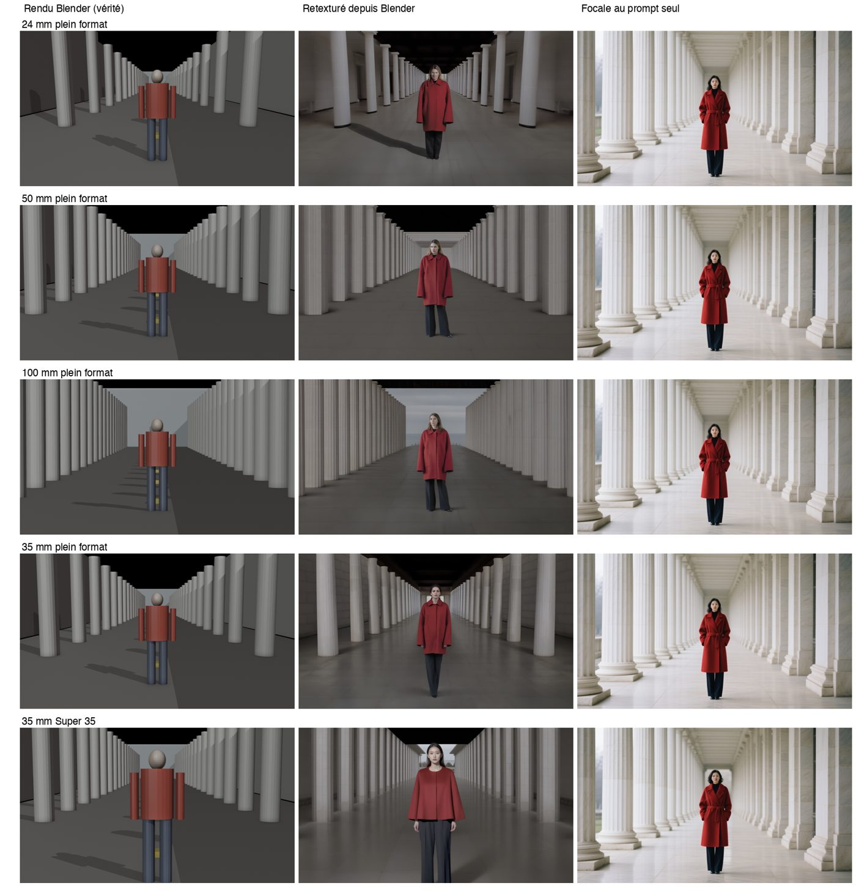
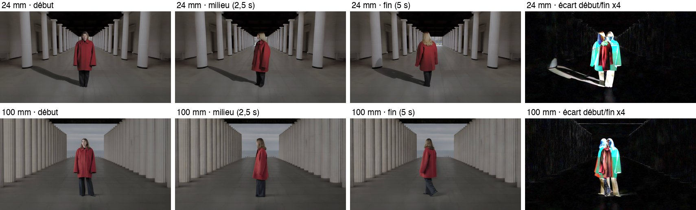

<picture><source media="(prefers-color-scheme: dark)" srcset="banner.svg"></picture>

[English](README.md) · [Français](README.fr.md)

# Atlas génératif 2026

Un comparatif des modèles de génération vidéo et image au 15 octobre 2026, variante par variante : ce que chacun accepte en entrée (texte, images de référence, vidéos de référence, sons de référence, première et dernière image, images-clés, 3D, cartes de contrôle, LoRA), ce qu'il produit (durée, résolution, son natif, synchronisation labiale), ses fonctions d'édition, son classement indépendant, s'il tourne en local sur une RTX 5090, une RTX 4090 ou un Mac M5 Max de 128 Go, et ce qu'il coûte, plateforme par plateforme. Il est fait pour des cinéastes qui doivent choisir un outil pour un plan donné, pas un modèle préféré.


## Ce qu'il contient

- `TABLES.md` : les deux grands tableaux (106 variantes vidéo, 81 variantes image), lisibles directement sur GitHub.
- `data/` : les données sources en JSON, un objet par variante, chacun avec ses sources datées.
  - `video-models.json`, `image-models.json` : fonctions, entrées, sorties, classement, modération, points forts et faiblesses.
  - `prices.json` : 651 prix sur 26 plateformes (API à l'usage, éditeurs, abonnements).
  - `local-runs.json` : si chaque modèle à poids ouverts tourne sur un Mac M5 Max 128 Go et sur une RTX 4090 24 Go, avec l'outil à utiliser.
  - `gpu-hour.json` : prix de location de GPU à l'heure.
  - `SCHEMA.md` : le format de chaque fichier.
- `scripts/` : lecteurs de prix (fal, OpenRouter, clouds GPU), fusion des prix, export des tableaux et construction d'une page interactive en un seul fichier (`python3 scripts/build_atlas.py`, sortie dans `site/`).
- `lab/focal-test/` : un test reproductible sur la focale et le capteur (plus bas).

## Guides

- [Raccorder un film hybride dans un look iPhone granuleux](guides/raccord-look-hybride.fr.md) : plans Blackmagic, iPhone, infrarouges et IA dans un même look. Gestion des couleurs, SDR ou HDR, ce qui fait le look iPhone, dégrain et regrain, ordre des passes, cas documentés ([English version](guides/hybrid-look-matching.md)).

## Comment le lire

- `?` veut dire que l'information n'est documentée nulle part où nous avons cherché. Rien n'est deviné.
- Chaque source est marquée `editeur` (annoncé par l'éditeur), `independant` (tiers, article, classement) ou `mesure` (mesuré par nous ou publié comme mesure).
- Les classements sont les scores Elo des arènes vidéo et image d'Artificial Analysis lus le 15 octobre 2026. À environ ±17 points près, deux modèles sont à égalité statistique.
- Les colonnes de prix le plus bas ne retiennent que les prix à l'usage. Les prix d'abonnement restent dans le détail de chaque modèle.
- Les notes des fichiers JSON sont rédigées en français.

## Ce qui ressort (15 octobre 2026)

- En image vers vidéo avec son, MiniMax H3, Seedance 2.5, Gemini Omni Flash et Wan 3.0 sont à égalité statistique en tête. Kling 3.0 et Veo 3.1 sont loin derrière, LTX-2.5 à environ 200 points.
- Les entrées diffèrent plus que la qualité. Seedance 2.5 prend jusqu'à 30 images, 10 vidéos et 10 sons, mais pas en même temps que la première et la dernière image. H3 Max combine jusqu'à 9 images, 3 vidéos et 3 sons avec première, dernière et une image intermédiaire. Wan 3.0 offre des plans de 30 secondes mais pas de LoRA.
- Le même modèle peut coûter deux fois plus cher selon la plateforme : Seedance 2.5 en 480p va de 0,10 à 0,18 dollar la seconde.
- En local, H3 tient sur une 4090 en INT8 ou FP8 et tourne sur Mac par Draw Things ou des portages communautaires, lentement. LTX-2.5 distillé est le modèle ouvert le plus rapide sur les deux.

<a id="mesures-maison"></a>
## Mesures maison : un 50 mm au prompt est-il un 50 mm ?

`lab/focal-test/` rend la même scène dans Blender (une silhouette dans une colonnade, colonnes tous les 3 m) à 24, 50 et 100 mm en plein format, en gardant le sujet à la même taille, et à 35 mm en plein format contre Super 35 depuis la même position. Chaque rendu est ensuite retexturé par un modèle d'image, et comparé à la même scène décrite au prompt avec la focale écrite en toutes lettres. Même modèle, même graine.



- Prompt seul : 24, 50 et 100 mm donnent presque la même image. Plein format et Super 35 sont identiques. Les mots règlent une ambiance, pas un angle de champ.
- Retexturé depuis Blender : le fond se resserre à 100 mm et s'ouvre à 24 mm comme avec un vrai objectif, et le Super 35 cadre plus serré.
- Animé 5 secondes avec un prompt « static shot, no zoom » (LTX-2.5), le 24 mm reste un 24 mm et le 100 mm reste un 100 mm. Seule la silhouette bouge.



Le couple capteur et optique se fixe dans l'image de départ (une mise en place 3D avec la vraie taille de capteur, ou une photo prise avec la vraie caméra), pas dans le prompt. Un estimateur automatique de focale (GeoCalib) a été essayé puis écarté : sur une perspective centrée à un seul point de fuite, il se trompe sur les rendus Blender de focale connue.

## Reconstruire

```
python3 scripts/fetch_openrouter.py      # liste publique, sans clé
FAL_KEY=... python3 scripts/fetch_fal.py # prix, lent (débit limité)
python3 scripts/merge-prices.py
python3 scripts/export_tables.py         # TABLES.md
python3 scripts/build_atlas.py           # site/index.html
```

## Limites

Les prix et les modèles changent chaque semaine. Beaucoup de cases restent à `?` parce que les éditeurs ne publient pas l'information, et les politiques de modération sur les visages réels sont rarement écrites. Les corrections sont bienvenues en issue, avec une source datée.

## Licence

Données et textes : [CC BY-SA 4.0](LICENSE). Code de `scripts/` et `lab/` : [MIT](LICENSE-CODE).

---

État vérifié au 15 octobre 2026.

Ismaël Joffroy Chandoutis, 2026. Textes sous licence [CC BY-SA 4.0](LICENSE).

Par [Ismaël Joffroy Chandoutis](https://ismaeljoffroychandoutis.com).
