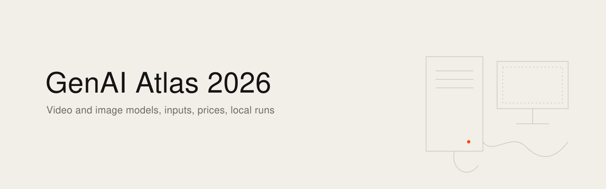
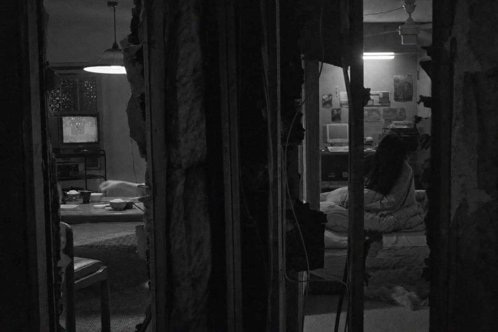
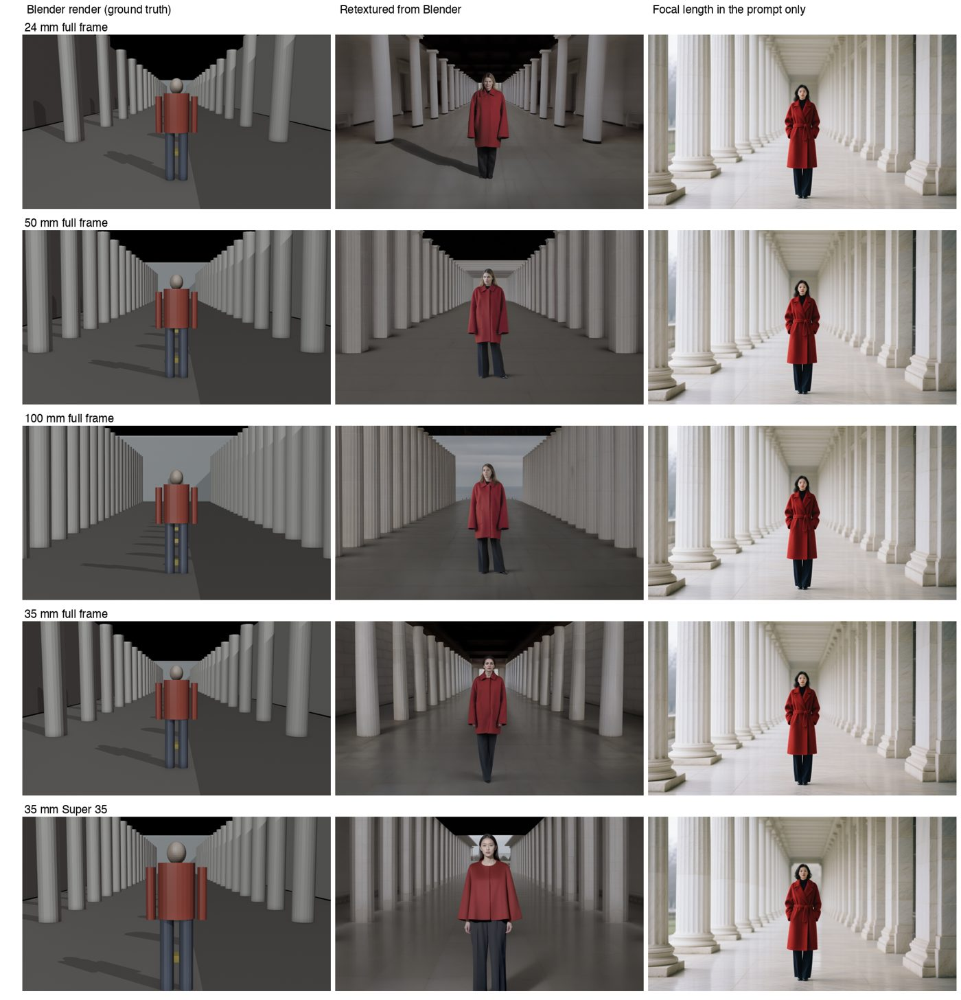
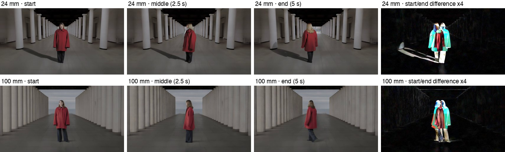

<picture><source media="(prefers-color-scheme: dark)" srcset="banner.svg"></picture>

[English](README.md) · [Français](README.fr.md)

# GenAI Atlas 2026

A comparison of generative video and image models as of 15 October 2026, variant by variant: what each one accepts as input (text, reference images, reference videos, reference audio, first and last frame, keyframes, 3D, control maps, LoRA), what it outputs (duration, resolution, native audio, lip-sync), its editing functions, its independent ranking, whether it runs locally on an RTX 5090, an RTX 4090 or a Mac M5 Max with 128 GB, and what it costs, platform by platform. It was built for filmmakers who need to choose a tool for a given shot, not a favourite model.



## What is inside

- `TABLES.md`: the two big tables (106 video variants, 81 image variants), readable directly on GitHub.
- `data/`: the source data in JSON, one object per variant, every object with dated sources.
  - `video-models.json`, `image-models.json`: capabilities, inputs, outputs, ranking, moderation, strengths and weaknesses.
  - `prices.json`: 651 prices across 26 platforms (pay-per-use APIs, vendors, subscriptions).
  - `local-runs.json`: whether each open-weight model runs on a Mac M5 Max 128 GB and on an RTX 4090 24 GB, with the tool to use.
  - `gpu-hour.json`: GPU rental prices per hour.
  - `SCHEMA.md`: the format of every file.
- `scripts/`: price readers (fal, OpenRouter, GPU clouds), the price merger, the table export and the builder of a single-file interactive page (`python3 scripts/build_atlas.py`, output in `site/`).
- `lab/focal-test/`: a reproducible test on focal length and sensor (see below).

## How to read it

- `?` means the information is not documented anywhere we could find. Nothing is guessed.
- Every source is tagged `editeur` (claimed by the vendor), `independant` (third party, paper, leaderboard) or `mesure` (measured by us or published as a measurement).
- Rankings are the Elo scores of the Artificial Analysis Video and Image Arenas read on 15 October 2026. Within about ±17 points, models are statistically tied.
- The cheapest price columns only use pay-per-use prices. Subscription prices are kept in each model's detail.
- Notes inside the JSON files are written in French.

## What stands out (15 October 2026)

- Image to video with audio: MiniMax H3, Seedance 2.5, Gemini Omni Flash and Wan 3.0 are statistically tied at the top. Kling 3.0 and Veo 3.1 are well behind, LTX-2.5 about 200 points behind.
- Inputs differ more than quality. Seedance 2.5 takes up to 30 images, 10 videos and 10 audio clips, but not together with first and last frame. H3 Max combines up to 9 images, 3 videos and 3 audio clips with first, last and an in-between frame. Wan 3.0 offers 30-second shots but no LoRA.
- The same model can cost twice as much depending on the platform: Seedance 2.5 at 480p goes from 0.10 to 0.18 USD per second.
- Locally, H3 holds on a 4090 with INT8 or FP8 weights and runs on a Mac through Draw Things or community ports, slowly. LTX-2.5 distilled is the fastest open model on both.

<a id="mesures-maison"></a>
## In-house measurements: is a 50 mm in the prompt a 50 mm?

`lab/focal-test/` renders the same scene in Blender (a figure in a colonnade, columns every 3 m) at 24, 50 and 100 mm on full frame, keeping the subject the same size, and at 35 mm on full frame against Super 35 from the same position. Each render is then retextured by an image model, and compared with the same scene described in the prompt with the focal length written in words. Same model, same seed.



- Prompt only: 24, 50 and 100 mm give almost the same picture. Full frame and Super 35 are identical. The words set a mood, not an angle of view.
- Retextured from Blender: the background compresses at 100 mm and opens at 24 mm as it does with a real lens, and Super 35 frames tighter.
- Animated for 5 seconds with a "static shot, no zoom" prompt (LTX-2.5), the 24 mm stays a 24 mm and the 100 mm stays a 100 mm. Only the figure moves.



The sensor and lens pair is set in the start image (a 3D layout with the real sensor size, or a photograph taken with the real camera), not in the prompt. An automatic focal estimator (GeoCalib) was tried and discarded: on a centred one-point perspective it misreads the known Blender renders.

## Rebuild

```
python3 scripts/fetch_openrouter.py      # public list, no key
FAL_KEY=... python3 scripts/fetch_fal.py # price endpoint, slow (rate limited)
python3 scripts/merge-prices.py
python3 scripts/export_tables.py         # TABLES.md
python3 scripts/build_atlas.py           # site/index.html
```

## Limits

Prices and models change every week. Many cells stay `?` because vendors do not publish the information, and moderation policies on real faces are rarely written down. Corrections are welcome as issues, with a dated source.

## License

Data and texts: [CC BY-SA 4.0](LICENSE). Code in `scripts/` and `lab/`: [MIT](LICENSE-CODE).

---

State verified on 15 October 2026.

Ismaël Joffroy Chandoutis, 2026. Texts under a [CC BY-SA 4.0](LICENSE) license.

By [Ismaël Joffroy Chandoutis](https://ismaeljoffroychandoutis.com).
